# KaryaKita — Skema Database (PostgreSQL)

Database: **PostgreSQL 16** · skema penuh di [`internal/db/schema.sql`](internal/db/schema.sql)
(dimigrasikan otomatis saat API pertama kali start, dicatat di `schema_migrations`).

36 tabel dalam 7 kelompok:

| Kelompok | Tabel |
|---|---|
| **Identitas** | `users` (profil + preferensi + kredensial), `sessions` (sesi login), `auth_tokens` (link verifikasi, reset password, ganti email, konfirmasi hapus akun), `designers`, `user_designs` (desain custom pribadi — tanpa royalti) |
| **Katalog** | `product_types`, `colors`, `product_type_colors`, `product_type_sizes`, `designs`, `listings`, `categories` (product tree), `attributes`, `attribute_values`, `design_attributes` |
| **Pencarian** | `listing_search` (search document per listing), `search_words` (vocabulary for typo correction), `search_synonyms` |
| **Transaksi** | `orders`, `order_items`, `payments`, `order_events`, `reviews` (ulasan terverifikasi + moderasi), `vouchers`, `payment_notifications` (jejak webhook/sync gateway) |
| **Kreator** | `design_submissions` (terbit jadi listing saat disetujui), `royalties`, `payouts` |
| **Keuangan** | `producers` (vendor cetak + kirim), `producer_charges` (hak vendor per pesanan), `producer_payouts` (transfer ke vendor) |
| **Analitik** | `track_events`, `web_vitals`, `api_metrics`, `search_terms`, `day_stats` |

## Diagram ERD

```mermaid
erDiagram
    users ||--o| designers : "profil kreator"
    users ||--o{ orders : "pesanan (nullable, guest ok)"
    users ||--o{ user_designs : "desain custom pribadi"
    users ||--o{ sessions : "sesi login"
    users ||--o{ auth_tokens : "link email"
    product_types ||--o{ user_designs : ""
    colors ||--o{ user_designs : ""

    designers ||--o{ designs : "membuat"
    designers ||--o{ design_submissions : "mengajukan"
    designers ||--o{ royalties : "menerima"
    designers ||--o{ payouts : "menarik saldo"

    product_types ||--o{ product_type_colors : ""
    colors ||--o{ product_type_colors : ""
    product_types ||--o{ product_type_sizes : ""
    product_types ||--o{ listings : ""
    product_types ||--o{ design_submissions : ""
    colors ||--o{ design_submissions : ""

    designs ||--o{ listings : "dijual sebagai"
    listings ||--o{ order_items : "dibeli via"
    categories ||--o{ product_types : "groups"
    attributes ||--o{ attribute_values : ""
    attribute_values ||--o{ design_attributes : ""
    designs ||--o{ design_attributes : "tagged with"
    listings ||--|| listing_search : "indexed as"
    listings ||--o{ reviews : "dinilai"
    orders ||--o{ reviews : "bukti pembelian"
    listings ||--o| design_submissions : "diterbitkan dari"

    orders ||--o{ order_items : "berisi"
    vouchers ||--o{ orders : "dipakai di"
    orders ||--|| payments : "dibayar via"
    orders ||--o{ order_events : "timeline"
    order_items ||--o| royalties : "menghasilkan"
    producers ||--o{ product_types : "mencetak"
    producers ||--o{ producer_charges : "berhak atas"
    orders ||--o{ producer_charges : "biaya produksi + ongkir"
    producer_payouts ||--o{ producer_charges : "melunasi"

    users {
        text id PK
        text username UK "unik tanpa beda huruf besar/kecil"
        text email UK
        text name
        user_role role "customer | designer | admin"
        text password_hash "bcrypt; NULL = akun Google saja"
        text google_sub UK "nullable"
        bool email_verified
        timestamptz last_login_at "nullable"
        timestamptz deleted_at "nullable; terisi = akun dianonimkan (migration 020)"
        timestamptz created_at
    }
    auth_tokens {
        text id PK "sha256(token)"
        text user_id FK
        auth_token_purpose purpose "verify_email | reset_password | change_email | delete_account"
        timestamptz expires_at "24 jam / 30 menit"
        timestamptz used_at "NULL = belum dipakai"
        text payload "data terikat token; change_email = email baru (migration 020)"
    }
    sessions {
        text id PK "sha256(token) — token mentah hanya di cookie"
        text user_id FK
        timestamptz expires_at "30 hari"
        timestamptz last_seen_at
        text user_agent
        text ip
    }
    designers {
        text id PK
        text user_id FK "nullable"
        text name
        text city
        text bio
        int hue
        int followers
        numeric rating
        text bank_name "nullable, rekening tujuan penarikan"
        text bank_account "nullable"
        text bank_holder "nullable"
    }
    product_types {
        text id PK "kaos | hoodie | mug | totebag"
        text label
        int base_price "Rupiah; di atasnya = bagian kreator"
        numeric print_max_w_cm
        numeric print_max_h_cm
        text producer_id FK "vendor yang mencetak"
        int production_cost "tarif vendor per pcs, <= base_price"
    }
    colors {
        text id PK
        text label
        text hex
    }
    product_type_colors {
        text product_type_id PK,FK
        text color_id PK,FK
        int sort
    }
    product_type_sizes {
        text product_type_id PK,FK
        text size PK
        int sort
    }
    designs {
        text id PK
        text designer_id FK
        text title
        text uri "data-URI / URL storage"
        text_arr tags
        timestamptz created_at
    }
    listings {
        text id PK
        text design_id FK
        text product_type_id FK
        int price
        int sold
        numeric rating
        text badge "nullable"
        bool active
    }
    orders {
        text id PK "KK-YYMMDD-nnnn"
        text user_id FK "nullable (guest)"
        text cust_name
        text cust_email
        text cust_phone
        text cust_address
        text cust_city
        int subtotal
        text courier
        int shipping_cost
        int discount "potongan voucher"
        text voucher_code FK "nullable"
        text cust_postal
        text notes "catatan untuk kurir"
        text shipped_courier "nullable — kurir yang mengirim"
        text tracking_number "nullable — resi, unik per kurir"
        timestamptz shipped_at "nullable"
        timestamptz delivered_at "nullable — laporan kurir paket tiba"
        timestamptz completed_at "nullable — dikonfirmasi pembeli / otomatis"
        timestamptz cancelled_at "nullable — dibatalkan karena tidak dibayar"
        int total
        order_status status "menunggu-pembayaran → dibayar → produksi → dikirim → tiba → selesai (atau dibatalkan)"
        timestamptz created_at
    }
    order_items {
        bigint id PK
        text order_id FK
        text listing_id FK "nullable, snapshot tetap ada"
        text title "snapshot"
        text type
        text color
        text size
        int qty
        int unit_price
        text design_uri "snapshot"
        int base_price "snapshot saat checkout"
        int production_cost "snapshot saat checkout"
        text producer_id FK "snapshot saat checkout"
    }
    payments {
        bigint id PK
        text order_id FK,UK
        text method "QRIS | GoPay | VA BCA | ..."
        payment_status status "pending | paid | expired | failed"
        text ref "ref gateway"
        int amount
        timestamptz paid_at "nullable"
        int gateway_fee "estimasi biaya Midtrans"
    }
    vouchers {
        text code PK "huruf besar"
        voucher_kind kind "percent | fixed | shipping"
        int value
        int min_subtotal
        int max_discount "nullable"
        timestamptz ends_at "nullable"
        int usage_limit "nullable"
        int per_user_limit
        bool active
    }
    order_events {
        bigint id PK
        text order_id FK
        text label "teks timeline"
        timestamptz at
    }
    design_submissions {
        text id PK "ds-xxxxxx"
        text designer_id FK "nullable"
        text designer_name
        text title
        text product_type_id FK
        text color_id FK
        int price
        text uri
        submission_status status "review | disetujui | ditolak"
        text note "catatan moderasi"
        timestamptz created_at
    }
    royalties {
        bigint id PK
        text designer_id FK
        bigint order_item_id FK,UK
        int amount "(harga jual - harga dasar) x qty"
        timestamptz created_at
    }
    payouts {
        bigint id PK
        text designer_id FK
        int amount
        payout_status status "diminta | diproses | dibayar | ditolak"
        timestamptz requested_at
        timestamptz paid_at "nullable"
        text bank_name "salinan rekening saat diajukan"
        text bank_account
        text bank_holder
        text reference "no. referensi transfer, nullable"
        text note "alasan tolak / catatan admin, nullable"
        timestamptz processed_at "nullable"
    }
    producers {
        text id PK
        text name
        text contact "nullable"
        text bank_name "nullable"
        text bank_account "nullable"
        text bank_holder "nullable"
        boolean active
    }
    producer_charges {
        bigint id PK
        text producer_id FK
        text order_id FK
        bigint order_item_id FK "NULL = ongkir"
        text kind "produksi | ongkir"
        int amount
        bigint payout_id FK "NULL = belum dibayar"
    }
    producer_payouts {
        bigint id PK
        text producer_id FK
        int amount
        text reference "no. referensi transfer"
        text note "nullable"
        timestamptz created_at
    }
    categories {
        text id PK "pakaian | tas | rumah"
        text label
        text emoji
        int sort
    }
    attributes {
        text id PK "tema | gaya | acara"
        text label
        int sort
        int max_per_design "how many values one design may carry"
    }
    attribute_values {
        text id PK "anime | retro | lebaran | ..."
        text attribute_id FK
        text label "unique per attribute"
        text emoji
        int sort
    }
    design_attributes {
        text design_id PK,FK
        text value_id PK,FK
    }
    listing_search {
        text listing_id PK,FK
        tsvector doc "A title, B tags + attribute labels, C product type + category, D creator"
    }
    search_words {
        text word PK "every word of an active listing"
        int ndoc "listings containing it"
    }
    search_synonyms {
        bigint id PK
        text_array terms "single words that mean the same"
    }
    reviews {
        bigint id PK
        text listing_id FK
        text order_id FK "bukti pembelian; unik per pasangan"
        text author
        int rating "1-5"
        text comment
        review_status status "review | disetujui | ditolak"
        text note "catatan moderasi"
    }
    user_designs {
        bigint id PK
        text user_id FK
        text title
        text product_type_id FK
        text color_id FK
        text uri "/uploads/... atau data-URI"
        numeric width_cm
        numeric offset_y_cm
    }
    track_events {
        bigint id PK
        text session_id "sesi anonim per-tab"
        text type "page_view | search | purchase | ..."
        text page
        text label
        text device
        bigint value
        timestamptz created_at
    }
    web_vitals {
        bigint id PK
        vital_name name "LCP | INP | CLS | TTFB"
        double value
        text page
        timestamptz created_at
    }
    api_metrics {
        bigint id PK
        text route
        text method
        int status
        double ms
        bool ok
        timestamptz created_at
    }
    search_terms {
        text term PK
        int count
    }
    day_stats {
        date date PK
        int visits
        int product_views
        int add_to_cart
        int checkout
        int paid
        bigint revenue
    }
```



> Tabel analitik (`track_events`, `web_vitals`, `api_metrics`, `search_terms`, `day_stats`)
> sengaja **tanpa foreign key** ke tabel transaksi — append-only, anonim, dan bisa dipindah ke
> warehouse terpisah tanpa memutus relasi.

## Keputusan desain

- **Uang = integer Rupiah.** Tidak ada pecahan sen di IDR; menghindari error floating point.
- **Snapshot di `order_items`.** Judul, harga, dan gambar desain disalin saat checkout, jadi
  pesanan lama tetap benar walau listing diubah/dihapus (`listing_id` nullable `ON DELETE` aman).
- **`payments` terpisah dari `orders`.** Siap untuk retry pembayaran/metode ganda, dan meniru
  webhook gateway: `PATCH {action:"pay"}` = notifikasi Midtrans/Xendit. Idempoten — bayar dua
  kali tidak menggandakan royalti (`ON CONFLICT (order_item_id) DO NOTHING`).
- **Pembagian uang dibukukan saat pembayaran** (`db.BookPaidOrder`, dipakai juga oleh seeder).
  Semua uang pembeli masuk ke rekening platform, lalu per item:
  kreator = (harga jual − harga dasar) × qty → `royalties`;
  vendor = biaya produksi × qty + ongkir pesanan (vendor yang mengirim) → `producer_charges`;
  Midtrans = estimasi → `payments.gateway_fee`; platform = sisanya
  (harga dasar − biaya produksi, biaya custom, dikurangi diskon voucher & biaya gateway).
  Harga dasar & biaya produksi disalin ke `order_items` saat checkout, jadi mengubah tarif vendor
  tidak mengubah pesanan lama. Idempoten lewat unique index (`royalties.order_item_id`,
  `producer_charges` per item / per pesanan untuk ongkir).
- **Vendor dibayar setelah paket dikirim.** Tagihan "siap bayar" = `producer_charges` tanpa
  `payout_id` yang pesanannya `dikirim/tiba/selesai`; mencatat pembayaran menautkan semuanya ke satu
  `producer_payouts` (nominal dihitung server).
- **Royalti baru bisa ditarik setelah pesanan `selesai`** (pembeli konfirmasi / selesai otomatis).
  Saldo tidak disimpan di kolom: `tersedia = SUM(royalti pesanan selesai) − SUM(payouts diminta/
  diproses/dibayar)`; payout `ditolak` mengembalikan dana. Satu pengajuan terbuka per kreator
  (unique index parsial), dan pengajuan mengunci baris `designers` supaya dua permintaan bersamaan
  tidak bisa menarik melebihi saldo. Minimal Rp50.000; transfer masih manual oleh admin.
- **Checkout wajib login.** Pesanan baru selalu punya `user_id` dan hanya bisa dilihat pemilik/admin;
  `user_id` tetap nullable untuk pesanan guest lama.
- **Harga dihitung server.** `order_items.unit_price`, ongkir, dan `discount` berasal dari database
  saat checkout, bukan dari browser. `total = subtotal + shipping_cost − discount`.
- **Pembayaran diputuskan gateway.** Lunas hanya setelah Status API Midtrans menyatakan settlement
  (webhook hanya pemicu). Kolom `payments.gateway_order_id` (`<no. pesanan>-<percobaan>`, unik),
  `snap_token`, `payment_type`. `payment_notifications` mencatat setiap notifikasi/cek (sumber, hasil,
  tanda tangan valid atau tidak). Pesanan tak dibayar 24 jam → `dibatalkan`; kuota voucher tidak
  menghitung pesanan dibatalkan.
- **Selesai hanya oleh pembeli.** `tiba` (wajib `delivered_at`, CHECK `orders_delivered_has_time`)
  → `selesai` lewat konfirmasi pembeli atau otomatis 48 jam setelah tiba (`completed_at`).
- **Resi wajib sebelum dikirim.** CHECK `orders_shipped_has_tracking`: status `dikirim`/`selesai`
  harus punya `shipped_courier`, `tracking_number`, `shipped_at`. Indeks unik
  `(lower(shipped_courier), tracking_number)` mencegah satu resi dipakai dua pesanan.
- **Voucher** dihitung pemakaiannya dari `orders.voucher_code` (kuota total & per akun), dikunci
  `FOR UPDATE` saat pesanan dibuat agar kuota tidak terlampaui. Diskon ditanggung platform —
  royalti tetap dari harga item.
- **Sesi di database, bukan JWT.** Cookie berisi token acak; tabel `sessions` hanya menyimpan
  hash-nya, jadi kebocoran database tidak membocorkan sesi aktif, dan logout/cabut akses
  berlaku seketika (cukup hapus barisnya).
- **Satu akun, dua cara masuk.** `password_hash` dan `google_sub` sama-sama nullable: akun
  password bisa ditautkan ke Google (email sama), akun Google tidak wajib punya password.
  Keunikan username & email memakai indeks `lower(...)`.
- **Enum PostgreSQL** untuk semua status — nilai tak valid ditolak di level database.
- **`day_stats`** = agregat harian (di-seed untuk demo, di produksi diisi job harian dari
  `track_events`); statistik hari berjalan digabung live dari `track_events` di `GET /api/stats`.
- **Ulasan terverifikasi**: `reviews` unik per `(order_id, listing_id)`, hanya bisa dibuat dari
  pesanan berstatus `selesai`, dan tayang setelah moderasi. Rating listing diperbarui dengan
  smoothing (rating lama berbobot 50 penilaian).
- **Category, attributes, tags** (Etsy-style, migration 015): `categories` is the product tree
  (category → `product_types.category_id`, e.g. Pakaian → Kaos); `attributes` are curated facets
  of the design (Tema, Gaya, Acara) with admin-managed `attribute_values`, at most
  `max_per_design` each per design; `designs.tags` are free keywords from the creator (max 13).
- **Search** (`internal/api/search.go`): `listing_search.doc` is a weighted `tsvector` per listing,
  rebuilt by `db.ReindexSearch` (on publish, rename, (de)activate, attribute edits, and at every
  startup). A query word unknown to `search_words` is corrected to the closest known word
  (edit distance), expanded with `search_synonyms`, then prefix-matched. `search_terms.results`
  keeps the last result count of each term; `results = 0` are the gaps shown in the admin
  "Pencarian" tab.
- **Desain custom pribadi** (`user_designs`): dibeli sebagai `order_items` dengan
  `listing_id NULL` → otomatis tak pernah menghasilkan royalti dan tak tampil di katalog.
- **Gambar** disimpan sebagai file (`uploads/` lokal; S3/R2 di produksi) — database hanya
  menyimpan URL.
- **Pengaturan akun & hapus akun** (migration 020, `internal/api/account.go`): `auth_tokens.payload`
  mengikat email baru ke token `change_email`, sehingga alamat tujuan tidak bisa diganti setelah
  link dikirim; `users.email` baru berganti saat link dikonfirmasi. Menghapus akun = **anonimisasi**,
  bukan `DELETE`: baris `users` tetap (`deleted_at` terisi) agar `orders.user_id` /
  `designers.user_id` tidak putus; `email` → `deleted+<id>@deleted.invalid`, `username` →
  `deleted-<id>`, nama → "Pengguna dihapus", telepon/alamat/preferensi dikosongkan,
  `password_hash` & `google_sub` NULL (email/username lama bebas dipakai akun baru). Sesi, token,
  dan `user_designs` dihapus. Pesanan tetap lengkap dengan item/harga/pembayaran, tetapi identitas
  pembeli di `orders` (`cust_*`, `notes`) dikosongkan dan `reviews.author` diganti. Kreator:
  listing dinonaktifkan, pengajuan `review` ditolak, `designers` (nama/bio/rekening) dikosongkan;
  royalti, desain, dan riwayat `payouts` (termasuk salinan rekening saat transfer — catatan
  keuangan) dipertahankan. Penghalang: pesanan sendiri belum `selesai`/`dibatalkan`, penarikan
  `diminta`/`diproses`, royalti tertahan, atau saldo tersedia ≥ `PayoutMinimum`; akun admin tidak
  bisa dihapus. Saldo tersedia di bawah minimum tidak bisa ditarik, jadi hangus saat akun dihapus.

## Cara pakai

```bash
docker compose up -d          # Postgres 16 di :5432 (user/db: karyakita)
go run ./cmd/api              # migrasi + seed otomatis, API di :8081
```

Reset total: `docker compose down -v` lalu jalankan ulang API.

Koneksi manual: `docker exec -it karyakita-db psql -U karyakita -d karyakita`
